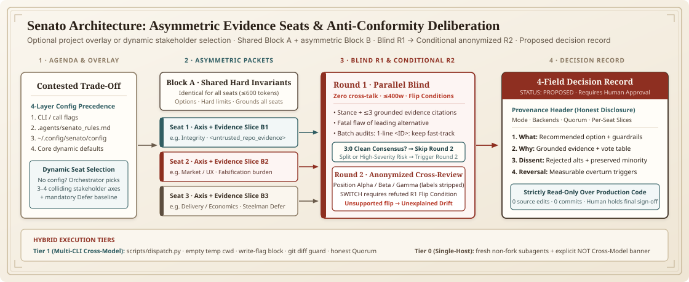

<div align="center">

<p align="center">
  
  &nbsp;&nbsp;
  
  &nbsp;&nbsp;
  
</p>

# 🏛️ Senato (세나토)

### *역할극은 그만. 비대칭 근거 좌석, 익명 반동조 교차검증, 소수의견 보존으로 진짜 트레이드오프를 중재한다.*

<p>
  <a href="./README.md">English</a> · <a href="./README.ko.md"><strong>한국어</strong></a>
</p>

<p>
  
  
  
  
</p>

> *'세나토(Senato, 베네치아 공화국 원로원)'는 중대한 정책을 실행하기 전에 상충하는 이해관계의 논변과 소수의견을 구조화된 라운드로 기록·심의하고, 최종 비준 권한을 분리했던 르네상스 합의 기구입니다.*
>
> **Senato**(`/senato`, `/snt`)는 외부 의존성 없이 동작하는 다좌석 트레이드오프 심의 스킬입니다 — **멀티-CLI 교차 모델 또는 단일 호스트 격리 실행을 지원하며, 심의 중 프로덕션 코드는 읽기 전용으로 유지하고 커밋 0건을 지킵니다.**

</div>

---

## 🔥 문제의식: 같은 컨텍스트 위의 역할극은 집단사고로 무너진다

단기 출시 일정 대 장기 유지보수, 가격 정책 대 고객 이탈, 보안 격리 대 생태계 확장처럼 **객관적 정답이 하나가 아닌 결정**에서, 모델 하나에 같은 프롬프트를 주고 *"아키텍트·마케터·PM 역할을 맡아 토론해줘"*라고 시키면 세 가지 문제가 반복됩니다:

1. **페르소나 역할극과 조기 합의 붕괴:** 똑같은 컨텍스트를 받은 직함 페르소나들은 1라운드에서 바로 무난한 절충안으로 3:0 수렴해 버리며, 시간만 늘고 오히려 단일 프롬프트보다 적은 리스크를 찾아냅니다.
2. **2라운드 동조 표류 (Conformity Drift):** 1라운드에서 의견이 갈려도, 2라운드에서 다수 의견이나 권위 있는 모델·직함 라벨을 보는 순간 소수파가 원래 반론을 반증받지도 않은 채 슬그머니 의견을 접어버립니다.
3. **설정 부담 대 불변식 환각:** 모든 프로젝트에 수동 규칙 파일 작성을 강제하면 신규 레포에서 쓰기 어렵고, 반대로 컨텍스트를 무작정 쪼개면 핵심 제약을 못 본 좌석이 엉뚱한 반박을 쏟아냅니다.

---

## 🏛️ Senato 작동 원리: 상충 이해관계 축 + 비대칭 근거 패킷

Senato는 직함 역할극 대신 **상충 최적화 축**, **비대칭 근거 슬라이스**, **반동조 교차검증 규약**을 결합합니다:

<p align="center">
  
</p>

1. **Stage 1 — 선택적 규칙 오버레이 또는 오케스트레이터 동적 좌석 선택:**
   - 4단계 우선순위로 설정을 해석합니다: 호출 인자 → 프로젝트 규칙 파일(`.agents/senato_rules.md`, `.agents/council_rules.md`, `SENATO.md`, `COUNCIL.md`, `docs/council_rules.md` 중 선택) → 사용자 머신 멀티-CLI 설정(`~/.config/senato/config.json`, 선택) → 코어 기본값.
   - **설정 파일 없이 바로 시작:** 프로젝트 규칙 파일이 없으면, 프로젝트 맥락을 파악한 호출 오케스트레이터가 **이번 안건에서 실제로 충돌하는 3~4개 이해관계 축**(예: *시스템 무결성* vs *시장·사용자 가치* vs *개발 공수·일정/유보 기준선*)을 동적으로 고르고 좌석별 **반증 의무(Falsification Burden)**를 부여합니다.
2. **Stage 2 — 2계층 비대칭 컨텍스트 패킷 (`Block A + Block B`):**
   - **Block A *(공통 하드 불변식, ≤600토큰)*:** 전 좌석에 100% 동일 주입 — 결정 질문, 후보 옵션(항상 최소안 또는 `Defer` 기준선 포함), 절대 위반 불가 제약을 공유해 모든 좌석을 확정 제약에 고정하고 제약 이탈 반박을 줄입니다.
   - **Block B *(좌석별 비대칭 근거 슬라이스)*:** 각 좌석의 이해관계 렌즈에 해당하는 문서·코드·지표·조사 자료만 분리 주입하고, 모든 저장소 발췌문을 `<untrusted_repo_evidence path="...">` 경계 태그로 감싸 프롬프트 인젝션을 차단합니다.
3. **Stage 3 — 병렬 블라인드 1라운드 → 조건부 익명 2라운드 → 분열 시 3라운드 오너 최종 변론:**
   - **Round 1 *(병렬 · 좌석당 ≤400단어)*:** 상호 열람 없이 `Stance`, 근거 인용(≤3건), 유력 대안의 치명적 결함, 그리고 **내 표를 바꿀 구체적 반증 조건(`Flip Condition`) 1~2개**를 제출합니다. 다항목 감사 시 유지 항목은 `- <ID>: keep` 1줄로 끝내는 패스트트랙을 지원합니다.
   - **에스컬레이션 게이트:** 미해결 고위험 충돌 없는 `3:0` 만장일치면 2·3라운드를 자동 생략하고, 표가 갈리거나 중대한 미해결 리스크가 있으면 2라운드로 넘어갑니다.
   - **Round 2 *(익명 `Alpha / Beta / Gamma`)*:** 모델명·좌석명을 모두 지운 채 쟁점만 교차 검토합니다. 입장을 바꾸려면 **1라운드 `Flip Condition` 중 어느 항목이 어떤 근거로 반증되었는지** 명시해야 하며, 근거 없는 변심은 `Unexplained Drift`로 표기하고 원 소수의견을 끝까지 보존합니다.
   - **Round 3 *(조건부 오너 최종 변론 · 좌석당 ≤200단어)*:** 2라운드 이후에도 표가 갈린 경우(`2:1`·`1:1:1`)에만 발동합니다. 억지 타협이나 입장 변경 없이 각 좌석이 표를 고정한 채 **오너를 향해 직접** "내 안을 택해 얻는 것", "의도적으로 포기·감수해야 하는 대가", "상대 안의 포기 비용이 더 큰 이유"를 제시합니다.
4. **Stage 4 — 사용자 언어 현지화 4필드 결정 기록 & 인간 승인 경계:**
   - 모든 제목·실행 정보·단일 호스트 비독립성 고지·승인 필요 문구를 사용자 언어로 자연스럽게 출력하고, 최상단 **`검토한 선택지`** 표로 모든 후보를 같은 해상도로 먼저 공개합니다.
   - 프로덕션 코드를 전혀 수정하지 않은 채 4대 필수 섹션(`1. 채택안/분열 대조 — 얻는 것 vs 포기·감수하는 것 및 오너 선택 기준`, `2. 채택 이유 및 좌석별 판단`, `3. 기각 사유 및 보존된 소수의견`, `4. 번복 조건 및 영향 범위`)을 좌석 인용 근거만으로 정리해 최종 결정을 사람에게 넘깁니다.

---

## ⚡ 비포 / 애프터 예시: 오픈소스 개발자 CLI의 플러그인 아키텍처 결정

> **시나리오:** 메인테이너 2명이 운영하는 오픈소스 Rust CLI에 v2.0 플러그인 시스템을 넣으려 합니다. **Option A** 내장 WASM 런타임, **Option B** 서브프로세스 JSON-RPC, **Option C** 선언형 YAML 훅 전용 중 하나를 골라야 하며, 보안(`.env`·SSH 키 노출), 생태계 채택(Python/TS로 로컬 CLI 래핑 수요), 바이너리·CI 예산(`4.2 MB`, 콜드스타트 `14 ms`)이 정면 충돌합니다.

| 방식 | 각 검토자가 보는 입력 | 결과 |
|---|---|---|
| **단일 프롬프트** | 전체 문서를 한 스레드에 투입 | 그럴듯한 장단점 요약을 내놓지만, 결론이 정해지면 소수 리스크와 측정 가능한 번복 조건이 흐려짐 |
| **동일 컨텍스트 3인 역할극** | 같은 입력에 *"아키텍트·PM·매니저 역할"*만 부여 | 세 역할 모두 1라운드에서 바로 `3:0` 만장일치 절충안으로 수렴하며 날카로운 트레이드오프가 뭉개짐 |
| **Senato** *(비대칭 패킷 + 익명 R2)* | 공통 **Block A** 불변식 + 좌석별 분리된 **Block B** 근거(`threat_model.md` vs `plugin_requests.md` vs `build_footprint.md`) | 1라운드가 `2:1`로 분열(보안·공수는 C, 생태계는 B). 익명 2라운드(`Alpha/Beta/Gamma`)에서 YAML `.env`/파일 보간 취약점까지 포착하고, **반증되지 않은 소수의견**(비공식 쉘 래퍼 양산 리스크)과 측정 가능한 번복 조건을 결정 기록에 함께 보존 |

<details>
<summary><strong>📄 4필드 결정 기록 출력 구조 미리보기</strong></summary>

```text
심의 결론
- 결과: 2:1 의견 분열 — Option C(다수 권고) vs Option B(소수 대안 보존) (제안됨 · 사용자 명시 승인 필요)
- 실행 정보: 다중 모델 교차 심의 (3/3 참여 · 코드 변경 없음) · 1R + 익명 2R + 3R 오너 최종 변론 (2:1) · 동적 비대칭 분리

검토한 선택지
- Option A (내장 WASM): 기각
- Option B (서브프로세스 JSON-RPC): 소수 대안 (1/3)
- Option C (선언형 YAML 훅 전용): 다수 권고 (2/3)

1. 오너 선택 대조 (얻는 것 vs 포기·감수하는 것):
   - Option C (다수안): 14 ms 콜드스타트·2인 CI 예산 확보 / 상태 기반 API 훅 포기(외부 쉘 래퍼 우회 위험 감수)
   - Option B (소수안): Python/TS 상태 기반 플러그인 확보 / OS 강제 샌드박스 부재로 비밀키 노출 위험 감수
   - 오너 선택 기준: 콜드스타트·보안 경계가 우선이면 Option C, 상태 기반 훅이 필수라면 Option B
   - 공통 가드레일: v2.0 YAML 훅에서 쉘 실행 및 .env/파일 보간 금지
2. 분열 이유 및 좌석별 판단: 보안·공수 좌석은 R2에서도 Option C 유지, 생태계 좌석은 쉘 래퍼 우회 반론 보존 (좌석별 근거 표)
3. 기각 사유 및 보존된 소수의견:
   - 탈락: Option A (+28 MB, 140 crates)
   - 보존된 소수의견: 정적 YAML만 제공하면 팀들이 통제 없는 외부 쉘 래퍼로 우회할 위험 잔존
4. 번복 조건 및 영향 범위:
   - 활성 팀의 30% 초과(>30%)가 상태 기반 API 훅을 요구하고 OS 수준 샌드박스 또는 체크섬 신뢰 모델이 검증되면 Option B 재검토
```

</details>

---

## ⚡ 하이브리드 실행과 읽기 전용 가드

Senato는 에이전트 1개만 있어도 바로 동작(**Tier 0**)하며, 여러 CLI를 함께 쓰는 환경에서는 코어에 벤더 플래그를 하드코딩하지 않고 실제 크로스-모델 심의(**Tier 1**)로 확장됩니다:

| 티어 | 실행 방식 | 읽기 전용 가드 및 투명성 규약 |
|---|---|---|
| **Tier 0 *(기본)*** | 단일 호스트 격리 서브에이전트 (`Claude Code`, `Antigravity`, `Codex CLI`) | `fork` 없는 새 서브에이전트(프롬프트·서브에이전트 경계 기반 읽기 전용) + 사용자 언어 상단 고지 강제(*"단일 호스트 동일 모델 — 비대칭 근거 분리, 교차 모델 독립 아님"*) |
| **Tier 1 *(멀티-CLI 확장)*** | `skill/senato/scripts/dispatch.py` + 사용자 선언적 어댑터 설정 (`~/.config/senato/config.json`) | 좌석별 빈 임시 디렉터리(`cwd`) 실행, UTF-8 바이트/파일 직접 전송(쉘 파이프 제거), 알려진 쓰기/권한 우회 플래그 차단 목록(`FORBIDDEN_WRITE_FLAG`), 타임아웃 시 프로세스 그룹/트리 종료, 추적·미추적 Git 워크스페이스 변조 탐지(`git status` + `git diff HEAD`), 부분 실패 시 `Quorum: k/N` 정직 보고 |

<details>
<summary><strong>🔒 멀티-CLI 선언적 어댑터 설정 (`~/.config/senato/config.json`)</strong></summary>

[`examples/adapters.example.json`](./examples/adapters.example.json)을 `~/.config/senato/config.json`에 복사(또는 `$SENATO_CONFIG` 지정)한 뒤 자가진단을 실행합니다 (Tier 1 크로스-모델 실행은 `usable >= 2` 필요):

```bash
python3 skill/senato/scripts/dispatch.py --doctor
```

`dispatch.py`는 알려진 쓰기·권한 우회 플래그(`--permission-mode acceptEdits|bypassPermissions|auto`, `--dangerously-skip-permissions`, `-s workspace-write`, `--mode auto`, `--allowedTools Edit|Write|Bash`, `--full-auto` 등)가 포함된 어댑터를 프로세스 실행 전에 즉시 차단하며, `--workspace <repo>` 지정 시 실행 전후 추적·미추적 Git 워크스페이스 변조를 자동 감시합니다.

</details>

---

## 🎯 언제 쓰면 좋은가 (언제 피할까)

- **둘 이상의 타당한 가치가 정면 충돌할 때** — 일정 대 아키텍처, 마케팅 포지셔닝 대 개발 공수, 보안 격리 대 생태계 채택.
- **근거·반대의견·번복 조건이 남는 결정 기록이 필요할 때** — AI 권고안(`PROPOSED`)과 사람의 최종 승인을 섞지 않고 기록.
- **기존 결정·규칙 목록을 일괄 재점검할 때** — 유지 항목은 `- <ID>: keep` 1줄로 넘기고 변경 제안 항목만 집중 심의.

단일 스펙의 착수 전 타당성 검토는 [Sinopia](https://github.com/Excelsus4/sinopia), 열린 발산 아이데이션은 [Sfumato](https://github.com/Excelsus4/sfumato), 코드 diff 환경 경계 결함 감사는 [Sprezzatura](https://github.com/Excelsus4/sprezzatura)가 더 적합하며, 일상적인 일반 구현 작업에는 쓰지 않습니다.

---

## 🚀 설치 및 사용법 (외부 의존성 0)

Senato 실행에 필요한 모든 파일은 [`skill/senato/`](./skill/senato/) 아래 **마크다운 4개 + 순수 Python 3.9+ 표준 라이브러리 스크립트 1개(`scripts/dispatch.py`)**로 구성됩니다:

```bash
# Claude Code (원스텝 마켓플레이스 설치, v2.1.275+)
/plugin install senato --marketplace Excelsus4/senato
```

```bash
git clone https://github.com/Excelsus4/senato.git && cd senato

# macOS / Linux / Git Bash
bash tools/install.sh --dry-run
bash tools/install.sh --target claude                # claude | agy | codex | all | auto
bash tools/install.sh --target agy --agy-mode plugin # agy 기본값 (또는 --agy-mode skill)
```

```powershell
# Windows PowerShell 5.1+ / PowerShell 7
powershell -ExecutionPolicy Bypass -File tools\install.ps1 -DryRun
powershell -ExecutionPolicy Bypass -File tools\install.ps1 -Target all
```

<details>
<summary>수동 복사 설치 (설치 스크립트 없이)</summary>

기존 `senato` 폴더가 있다면 중첩(`senato/senato`)되지 않도록 먼저 제거한 뒤 복사하세요:

```bash
# Claude Code (+ /senato, /snt 슬래시 명령)
mkdir -p ~/.claude/skills ~/.claude/commands
rm -rf ~/.claude/skills/senato
cp -r skill/senato ~/.claude/skills/senato
cp commands/*.md ~/.claude/commands/

# Antigravity (agy) — skill 모드 (네이티브 플러그인 모드는 tools/install.* 사용)
mkdir -p ~/.gemini/config/skills
rm -rf ~/.gemini/config/skills/senato
cp -r skill/senato ~/.gemini/config/skills/senato

# Codex CLI
mkdir -p ~/.codex/skills
rm -rf ~/.codex/skills/senato
cp -r skill/senato ~/.codex/skills/senato
```

</details>

### 사용 예시

```text
/senato v2.0에서 선언형 YAML 훅과 서브프로세스 JSON-RPC 플러그인 중 어느 쪽을 채택할지 심의해줘
/snt 90일 갱신 고지 전에 정액제 유지 vs 하이브리드 종량제 전환 트레이드오프 정리해줘
```

### 로컬 검증 (개발용)

테스트 스위트는 Python 3.9+ 표준 라이브러리(`unittest`)만 사용하며 격리 모드(`-I -B`)에서 동작합니다:

```bash
python3 -I -B -m unittest discover -s tools -p test_tools.py -v
```

---

## 🧩 함께 쓰는 르네상스 4부작 스킬

Senato는 작업 단계마다 서로 다른 컨텍스트 격리 축을 적용하는 무의존성 에이전트 스킬 **Renaissance Craft Quartet**의 일원입니다:

| 도구 | 단계 | 격리 축 | 핵심 역할 |
|---|---|---|---|
| **[Sinopia](https://github.com/Excelsus4/sinopia)** (`/snp`) | **착수 전** | 수직 *(레지스터 격리)* | 일상어 상담 + 정제 브리프 기반 격리 시니어 검토 |
| **[Sfumato](https://github.com/Excelsus4/sfumato)** (`/sfm`) | **발산 탐색** | 수평 *(도메인 격리)* | 이종 도메인 마스킹으로 LLM 동질화를 깨는 아이데이션 |
| **Senato** (`/snt`, *이 저장소*) | **의사결정 중재** | 이해관계 *(근거 격리)* | 비대칭 근거 좌석과 익명 반동조 검증 기반 다좌석 심의 |
| **[Sprezzatura](https://github.com/Excelsus4/sprezzatura)** (`/spz`) | **구현 후 QA** | 결함 클러스터 *(증거 격리)* | 로컬 테스트를 통과하는 환경 경계 버그 읽기 전용 감사 |

[MIT License](./LICENSE)에 따라 배포됩니다.

---

<div align="center">


*“좋은 조언은 어디에서 오든 결국 군주의 분별력에서 비롯되며, 군주의 분별력이 좋은 조언에서 나오는 것이 아니다.” — 니콜로 마키아벨리, 《군주론》 제23장 (1532)*

<sub>모든 이탈리아 중세·르네상스 명화 이미지는 Wikimedia Commons의 퍼블릭 도메인 또는 CC0 자료입니다.</sub>

</div>
