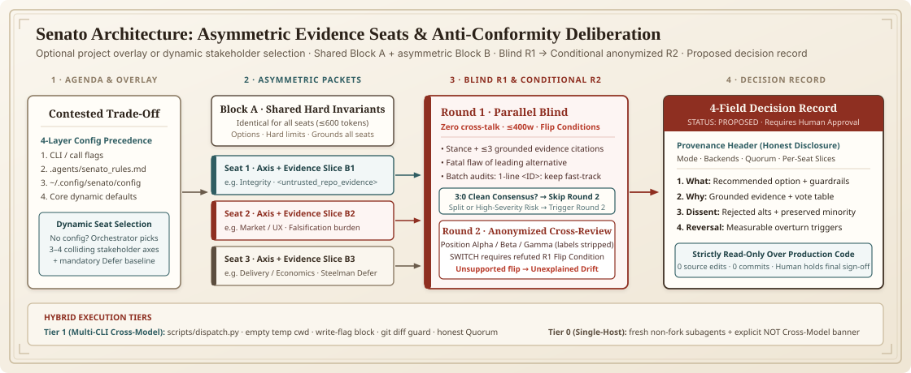

<div align="center">

<p align="center">
  
  &nbsp;&nbsp;
  
  &nbsp;&nbsp;
  
</p>

# 🏛️ Senato

### *Stop roleplay theater. Arbitrate real trade-offs with asymmetric evidence seats, anonymized cross-review, and preserved dissent.*

<p>
  <a href="./README.md"><strong>English</strong></a> · <a href="./README.ko.md">한국어</a>
</p>

<p>
  
  
  
  
</p>

> *"Senato" (*Senato Veneziano*, the Venetian Republic's deliberative senate) separated formal argument, dissent recording, and executive ratification so high-stakes choices were weighed across competing interests before action.*
>
> **Senato** (`/senato`, `/snt`) is a zero-dependency multi-seat deliberation skill for frontier coding agents — **hybrid multi-CLI or single-host isolated execution, read-only over production code, and zero commits during deliberation.**

</div>

---

## 🔥 The Problem: Same-Context Persona Prompts Collapse Into Groupthink

When a decision has no single objectively right answer — shipping speed vs. long-term maintainability, pricing vs. retention, security vs. adoption — asking one model to *"act as Architect, Marketer, and PM"* over the same prompt fails predictably:
1. **Persona Theater & Premature Consensus:** Given identical context, separate job-title personas converge immediately on the same polite compromise, adding latency while surfacing *fewer* real risks than a single thorough prompt.
2. **Round-2 Conformity Drift:** Even when seats disagree in Round 1, seeing a majority vote or authoritative label in Round 2 causes minority seats to fold without refuting their original objection.
3. **Configuration Tax vs. Hallucinated Objections:** Forcing users to author rigid config files blocks adoption on fresh repos, while blindly splitting context hides hard constraints and triggers irrelevant objections.

---

## 🏛️ How Senato Works: Competing Stakeholder Axes + Asymmetric Packets

Senato replaces job-title roleplay with **competing optimization axes**, **asymmetric evidence slices**, and an **anti-conformity review protocol**:

<p align="center">
  
</p>

1. **Stage 1 — Optional Config Overlay or Dynamic Stakeholder Selection:**
   - Resolves rules in 4 layers: invocation flags → optional project rules (`.agents/senato_rules.md`, `.agents/council_rules.md`, `SENATO.md`, `COUNCIL.md`, or `docs/council_rules.md`) → optional user multi-CLI adapter config (`~/.config/senato/config.json`) → public core defaults.
   - **Zero-Config by Default:** When no project rules file exists, the calling orchestrator uses its project awareness to dynamically select **3–4 genuinely colliding stakeholder axes** for that specific agenda (e.g., *System Integrity* vs. *Market Value* vs. *Delivery Scope & Deferral Economics*) and assigns each seat an explicit **Falsification Burden**.
2. **Stage 2 — 2-Tier Asymmetric Context Packets (`Block A + Block B`):**
   - **Block A *(Shared Hard Invariants, ≤600 tokens)*:** Identical for every seat — exact question, candidate options (always including a minimal / `Defer` baseline), and non-negotiable constraints to ground every seat against settled invariants and reduce out-of-constraint objections.
   - **Block B *(Asymmetric Evidence Slice)*:** Disjoint per-seat repository files, specs, metrics, or research excerpts relevant only to that seat's stakeholder lens, wrapped in `<untrusted_repo_evidence path="...">` prompt-injection boundaries.
3. **Stage 3 — Blind Parallel Round 1 → Conditional Anonymized Round 2:**
   - **Round 1 *(Parallel, ≤400 words/seat)*:** Zero cross-talk. Each seat outputs `Stance`, ≤3 concrete `Lens Evidence` citations, `Fatal Flaw of Leading Alternative`, and **1–2 falsifiable `Flip Conditions`**. Multi-item audits support a token-saving 1-line `- <ID>: keep` fast-track.
   - **Escalation Gate:** A clean `3:0` unanimous vote with zero unresolved high-severity invariant conflicts skips Round 2 automatically. Any split or unresolved severe risk triggers Round 2.
   - **Round 2 *(Anonymized `Alpha / Beta / Gamma`)*:** Strips model names and seat labels. A seat may switch its stance **only** by naming which Round 1 `Flip Condition` was refuted by concrete evidence; unsupported capitulation is flagged as `Unexplained Drift` and original minority dissent is preserved.
4. **Stage 4 — 4-Field Decision Record & Explicit Human Approval Gate:**
   - Opens with an honest **Provenance Header** (`Execution Mode`, `Backends / Quorum`, `Context Mode`, `Rounds`) — explicitly flagging single-host runs as `NOT Cross-Model Independent`.
   - Outputs four mandatory sections (`What` marked `STATUS: PROPOSED (Requires Explicit Human Approval)`, `Why`, `Rejected Alternatives & Preserved Dissent`, `Reversal Criteria & Impact Scope`) while leaving production code untouched.

---

## ⚡ Before / After Walkthrough: Adding Community Plugins to a Developer CLI

> **Scenario:** A 2-maintainer open-source Rust CLI needs a v2.0 plugin architecture: **Option A** embedded WASM runtime, **Option B** subprocess JSON-RPC plugins, or **Option C** declarative YAML hooks only. Security (`.env` / SSH key exposure), developer adoption (Python/TS wrapping local tools), and binary/CI budget (`4.2 MB`, `14 ms` cold start) collide directly.

| Approach | What Each Reviewer Sees | What Happens |
|---|---|---|
| **Single Prompt** | All docs dumped into one thread | Produces a sensible prose recommendation, but omits measurable reversal triggers and drops minority concerns once a winner is picked |
| **Same-Context 3-Persona Roleplay** | Identical prompt with *"Act as Architect / PM / Manager"* | All 3 personas converge immediately on the same polite `3:0` consensus in Round 1, smoothing away the sharpest trade-offs |
| **Senato** *(Asymmetric Packets + Anonymized R2)* | Shared **Block A** invariants + disjoint **Block B** slices (`threat_model.md` vs. `plugin_requests.md` vs. `build_footprint.md`) | Round 1 splits `2:1` (Security + Scope pick Option C; Adoption picks Option B). Round 2 anonymizes positions (`Alpha / Beta / Gamma`), catches YAML `.env`/file-interpolation risks, and **preserves the unrefuted minority dissent** (shadow-IT shell wrapper risk) alongside measurable reversal criteria |

<details>
<summary><strong>📄 Inspect the 4-Field Decision Record Output Format</strong></summary>

```text
Senato Verdict & Provenance
- Recommended Option: Option C (Declarative YAML hooks for v2.0)
- Status: STATUS: PROPOSED (Requires Explicit Human Approval)
- Execution Mode: Multi-CLI Cross-Model (or Single-Host Same-Model [NOT Cross-Model Independent])
- Backends / Quorum: 3/3 | Context Mode: Dynamic Asymmetric Split | Rounds: R1 + Anonymized R2 (2:1)

1. What: Ship declarative YAML formatters/hooks in v2.0 (banning shell exec & .env/file interpolation)
2. Why: Preserves 14 ms cold start and 2-maintainer CI budget while avoiding advisory-only subprocess sandboxes
3. Rejected Alternatives & Preserved Dissent:
   - Rejected: Embedded WASM (+28 MB, 140 crates); Subprocess JSON-RPC (OS-UID secret exposure)
   - Preserved Minority Dissent: Static YAML may push teams toward ungoverned external shell wrappers
4. Reversal Criteria & Impact Scope:
   - Revisit Option B if >30% of active teams request stateful API hooks AND an OS-enforced sandbox or opt-in checksum trust model is vetted
```

</details>

---

## ⚡ Hybrid Execution & Read-Only Guards

Senato works out of the box on a single agent host (**Tier 0**) and upgrades cleanly to real cross-model deliberation across multiple installed CLIs (**Tier 1**) with zero vendor hardcoding in the core:

| Tier | Execution Mode | Read-Only Guards & Honest Disclosure |
|---|---|---|
| **Tier 0 *(Default)*** | Single-host isolated subagents (`Claude Code`, `Antigravity`, `Codex CLI`) | Fresh non-fork subagents (read-only by prompt/subagent boundary) + mandatory provenance banner: `Single-Host Same-Model [Asymmetric Context Split — NOT Cross-Model Independent]` |
| **Tier 1 *(Opt-In Multi-CLI)*** | `skill/senato/scripts/dispatch.py` + user declarative JSON config (`~/.config/senato/config.json`) | Empty temp `cwd` per seat, UTF-8 byte/file transport (zero shell piping), known write/bypass flag denylist (`FORBIDDEN_WRITE_FLAG`), subprocess group/tree termination on timeout, tracked/untracked git mutation detection (`git status` + `git diff HEAD`), and honest `Quorum: k/N` reporting |

<details>
<summary><strong>🔒 Inspect the Declarative Multi-CLI Config (`~/.config/senato/config.json`)</strong></summary>

Copy [`examples/adapters.example.json`](./examples/adapters.example.json) to `~/.config/senato/config.json` (or point `$SENATO_CONFIG` to it) and validate with `--doctor` (Tier 1 cross-model execution requires `usable >= 2`):

```bash
python3 skill/senato/scripts/dispatch.py --doctor
```

`dispatch.py` rejects adapters containing known write or permission-bypass flags (`--permission-mode acceptEdits|bypassPermissions|auto`, `--dangerously-skip-permissions`, `-s workspace-write`, `--mode auto`, `--allowedTools Edit|Write|Bash`, `--full-auto`, etc.) before spawning a process, and detects tracked/untracked git workspace mutations when `--workspace <repo>` is supplied.

</details>

---

## 🎯 When to Run It (and When Not To)

- **When two or more valid priorities collide** — deadline vs. architecture, market positioning vs. engineering budget, security boundary vs. ecosystem adoption.
- **When you need an auditable, reversible decision record** — capturing *What*, *Why*, *Rejected Alternatives & Preserved Dissent*, and *Reversal Criteria* without conflating AI recommendations with human approval.
- **When auditing a list of existing decisions or rules** — using the 1-line `- <ID>: keep` fast-track so uncontested items close immediately while contested items get full cross-review.

Skip Senato for single-spec pre-build checks ([Sinopia](https://github.com/Excelsus4/sinopia)), open-ended creative brainstorming ([Sfumato](https://github.com/Excelsus4/sfumato)), diff edge-case bug audits ([Sprezzatura](https://github.com/Excelsus4/sprezzatura)), or routine implementation tasks.

---

## 🚀 Installation & Usage (Zero External Dependencies)

Everything Senato needs lives in [`skill/senato/`](./skill/senato/) — 4 plain-text markdown specs plus 1 pure-stdlib Python dispatcher (`scripts/dispatch.py`, Python 3.9+ standard library only):

```bash
# Claude Code (one-step marketplace install, v2.1.275+)
/plugin install senato --marketplace Excelsus4/senato
```

```bash
git clone https://github.com/Excelsus4/senato.git && cd senato

# macOS / Linux / Git Bash
bash tools/install.sh --dry-run
bash tools/install.sh --target claude                # claude | agy | codex | all | auto
bash tools/install.sh --target agy --agy-mode plugin # default for agy (or --agy-mode skill)
```

```powershell
# Windows PowerShell 5.1+ / PowerShell 7
powershell -ExecutionPolicy Bypass -File tools\install.ps1 -DryRun
powershell -ExecutionPolicy Bypass -File tools\install.ps1 -Target all
```

<details>
<summary>Manual copy alternative (no installer script)</summary>

Remove any previous `senato` folder before copying so `cp -r` does not nest `senato/senato`:

```bash
# Claude Code (+ /senato and /snt slash commands)
mkdir -p ~/.claude/skills ~/.claude/commands
rm -rf ~/.claude/skills/senato
cp -r skill/senato ~/.claude/skills/senato
cp commands/*.md ~/.claude/commands/

# Antigravity (agy) — skill mode (use tools/install.* for native plugin mode)
mkdir -p ~/.gemini/config/skills
rm -rf ~/.gemini/config/skills/senato
cp -r skill/senato ~/.gemini/config/skills/senato

# Codex CLI
mkdir -p ~/.codex/skills
rm -rf ~/.codex/skills/senato
cp -r skill/senato ~/.codex/skills/senato
```

</details>

### Usage Examples

```text
/senato Should we ship declarative YAML hooks or subprocess JSON-RPC plugins in v2.0?
/snt Arbitrate flat-tier vs. hybrid metered pricing before our 90-day renewal notice window
```

### Local Verification (Development)

All tests use Python 3.9+ standard library (`unittest`) only and run cleanly in isolated mode (`-I -B`):

```bash
python3 -I -B -m unittest discover -s tools -p test_tools.py -v
```

---

## 🧩 Companion Tools & Design Lineage

Senato is part of the **Renaissance Craft Quartet** of zero-dependency agent skills — each applying strict context boundaries to a distinct stage of building:

| Tool | Stage | Isolation Axis | Focus |
|---|---|---|---|
| **[Sinopia](https://github.com/Excelsus4/sinopia)** (`/snp`) | **Pre-build** | Vertical *(register isolation)* | Plain-language intake + isolated senior review of a refined brief |
| **[Sfumato](https://github.com/Excelsus4/sfumato)** (`/sfm`) | **Divergence** | Horizontal *(domain isolation)* | Dual-track cross-domain ideation breaking LLM homogenization |
| **Senato** (`/snt`, *this repo*) | **Arbitration** | Stakeholder *(evidence isolation)* | Multi-seat trade-off deliberation with asymmetric evidence & preserved dissent |
| **[Sprezzatura](https://github.com/Excelsus4/sprezzatura)** (`/spz`) | **Post-build QA** | Cluster *(evidence isolation)* | Read-only fault-cluster audit catching bugs that pass local tests |

Licensed under the [MIT License](./LICENSE).

---

<div align="center">


*“Good counsel, from wherever it comes, must arise from the prudence of the prince, and not the prudence of the prince from good counsel.” — Niccolò Machiavelli, Il Principe, Ch. XXIII (1532)*

<sub>All Italian medieval and Renaissance artworks are Public Domain or CC0 via Wikimedia Commons.</sub>

</div>
